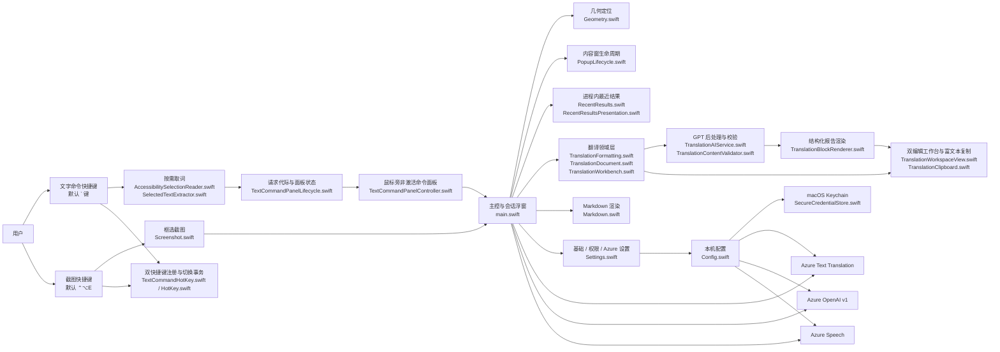
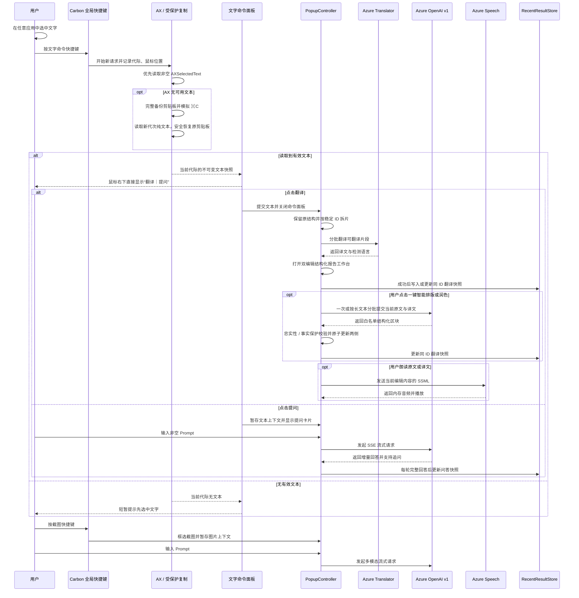

# 全局架构现状 (Architecture Overview)

> 本文件仅维护全局主干（两张 Mermaid 图 + 一组核心约束）。具体子系统或领域细节请在 `docs/architecture/` 下按需平铺新建专题 `.md` 文件。

## 1. 模块边界与源码地图

- **文字命令入口**（[TextCommandHotKey.swift](../../glint-app/TextCommandHotKey.swift)、[TextCommandEntryPolicy.swift](../../glint-app/TextCommandEntryPolicy.swift)）：用户选中文字后主动按快捷键才开始取词；鼠标释放、拖选、双击、键盘扩选、`⌘A` 与 `mouseMoved` 不会自动显示入口或触发复制。
- **按需取词**（[AccessibilitySelectionReader.swift](../../glint-app/AccessibilitySelectionReader.swift)、[SelectedTextExtractor.swift](../../glint-app/SelectedTextExtractor.swift)）：优先读取焦点元素及有限父链的非空 `AXSelectedText`；无文本时执行受保护的 `⌘C`，完整备份剪贴板并按代次安全恢复，拒绝空白、文件、图片与非文本对象。
- **文字命令面板**（[TextCommandPanelLifecycle.swift](../../glint-app/TextCommandPanelLifecycle.swift)、[TextCommandPanelController.swift](../../glint-app/TextCommandPanelController.swift)）：使用代际令牌拒绝晚到结果；读取成功后直接显示“翻译｜提问”，没有 marker 或 hover 阶段。面板为 non-activating `NSPanel`，位于当前鼠标右下约 12 pt，并夹紧在鼠标所在显示器 `visibleFrame` 内。
- **双快捷键事务**（[ScreenshotHotKey.swift](../../glint-app/ScreenshotHotKey.swift)、[TextCommandHotKey.swift](../../glint-app/TextCommandHotKey.swift)、[HotKey.swift](../../glint-app/HotKey.swift)）：截图和文字命令拥有独立配置与 Carbon 注册；`` ` `` 与 `F1–F20` 可以零修饰键注册，其他键必须包含 Control、Option、Shift 或 Command。候选先以非激活状态注册，只有持久化成功且旧注册安全注销后才切换；两套快捷键不得相同。
- **主控与会话浮窗**（[main.swift](../../glint-app/main.swift)）：连接快捷键、按需取词、命令面板、翻译、流式对话与截图流程。全局事件 Tap 只处理命令面板外部点击、Escape 与自愈，不观察选区手势。
- **最近结果**（[RecentResults.swift](../../glint-app/RecentResults.swift)、[RecentResultsPresentation.swift](../../glint-app/RecentResultsPresentation.swift)）：只在成功文字翻译或完整文字问答结束后写入纯文本快照；最多 10 条且总量不超过 10 MB。同一问答会话更新原条目，截图、草稿、错误和未完成流不进入历史。菜单按 ID 路由到唯一只读内容窗，不触发 Azure 请求。
- **智能翻译工作台**（[TranslationFormatting.swift](../../glint-app/TranslationFormatting.swift)、[TranslationDocument.swift](../../glint-app/TranslationDocument.swift)、[TranslationService.swift](../../glint-app/TranslationService.swift)、[TranslationWorkbench.swift](../../glint-app/TranslationWorkbench.swift)、[TranslationWorkspaceView.swift](../../glint-app/TranslationWorkspaceView.swift)）：本地层优先保留源应用已有换行、空行、列表和签名；Translator 按稳定 ID 拆片、预算分批并原位重组。初次翻译和重新翻译只调用 Translator；智能排版 / 润色由用户点击底部一键按钮后才调用 Azure GPT 同时处理两侧，并由 [TranslationContentValidator.swift](../../glint-app/TranslationContentValidator.swift) 执行字符忠实或事实保护校验。原文和译文均可编辑，重新翻译、单侧 AI 与双侧一键 AI 使用独立代际阻止晚到响应覆盖新内容。
- **结构化报告、复制与朗读**（[TranslationBlockRenderer.swift](../../glint-app/TranslationBlockRenderer.swift)、[TranslationClipboard.swift](../../glint-app/TranslationClipboard.swift)、[Config.swift](../../glint-app/Config.swift)）：已校验区块由固定 AppKit 样式渲染，模型不能控制视觉；纯文本复制保留内容结构，RTF 复制保留富文本层级。Speech 只持久化 Endpoint 与 Key，将 Portal Endpoint 转为 TTS URL，并自动选择 Neural Voice；原文 / 译文互斥播放，再点当前按钮停止，音频不落盘。
- **几何定位**（[Geometry.swift](../../glint-app/Geometry.swift)）：负责鼠标附近命令面板、内容浮窗边界夹紧以及多显示器截图坐标转换，不读取 AX 选区 bounds。
- **Azure 配置与协议**（[Config.swift](../../glint-app/Config.swift)、[SecureCredentialStore.swift](../../glint-app/SecureCredentialStore.swift)、[Settings.swift](../../glint-app/Settings.swift)）：Azure Translator、Azure OpenAI v1、Azure Speech 的 API Key 只进入 macOS Keychain；JSON 只持久化 Endpoint、Region、Deployment、翻译工作台最后选择及两套快捷键。旧明文配置在 Keychain 三项写入全部成功后才会原子改写为无 Key JSON，未知旧 JSON 的备份会递归移除 `apiKey` 字段。基础设置不再重复展示翻译目标和文本处理，Azure 页提供三组真实连接探测。
- **构建与打包**（[build.sh](../../glint-app/build.sh)）：生成 `arm64 + x86_64` Universal Binary、固定签名的 `Glint.app` 与 `Glint.dmg`。

## 2. 核心执行链路与数据流

## 3. 系统不变量与边界约束

- **显式意图约束**：只有文字命令快捷键可发起文字读取。普通鼠标/键盘选区动作、滚动、调整列宽和窗口大小不得自动复制或显示入口。
- **代际约束**：每次文字快捷键生成新代际；晚到 AX 或复制结果不得覆盖更晚请求。外部点击、Escape 与前台应用切换会使在途请求失效。
- **剪贴板事务约束**：仅在读取令牌仍有效时认领首个新 `changeCount`；仅当恢复时仍处于本事务复制代次才写回完整备份，第三方竞争更新优先保留。
- **类型过滤约束**：复制结果必须是新代次的非空文本；包含文件 URL、文件列表或图片类型时整体拒绝，不因同时带纯文本而放行。
- **非激活约束**：命令面板不得调用 `NSApp.activate` 或 `makeKeyAndOrderFront`；整个可见按钮区域可点击，主动作不依赖 hover。
- **双快捷键约束**：截图与文字命令快捷键不能相同；只有 `` ` `` 与 `F1–F20` 允许不带修饰键；注册、持久化或旧注册注销失败时，旧有效快捷键继续工作。
- **隐私约束**：Azure Key 仅保存在当前用户的 macOS Keychain；配置 JSON 与迁移备份不得出现 `apiKey` 字段或 Key 值，日志不得记录凭据、真实选中文字、剪贴板正文或聊天正文。
- **会话约束**：选中文字与截图上下文仅保存在当前进程内存中；Azure Translator 负责所有默认翻译，Azure OpenAI v1 只在用户主动点击智能排版 / 润色、提问、追问或截图理解时调用，Azure Speech 只处理用户主动点击朗读时的当前编辑内容。
- **排版约束**：本地层不得主动合并已有行。智能排版的 GPT 输出移除 Unicode 空白后必须与输入字符序列完全一致；智能润色必须保留全部受保护事实和列表顺序；任何解析、网络或校验失败都回退到 Translator 结果。严格模式只规范换行编码和尾随空格。
- **历史约束**：最近结果只存在于当前进程内存，不序列化；只保存文字结果的纯文本快照，不保存 AppKit 视图、截图、Base64、Timer、网络任务或 Azure messages。浏览历史时只有一个内容窗，当前空闲草稿可切回恢复。
