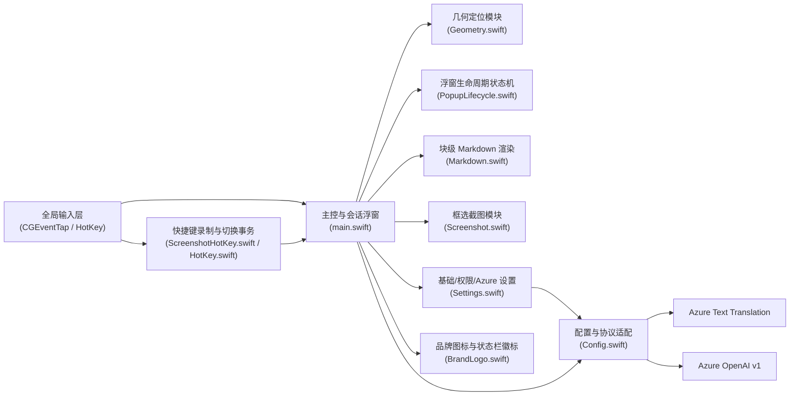
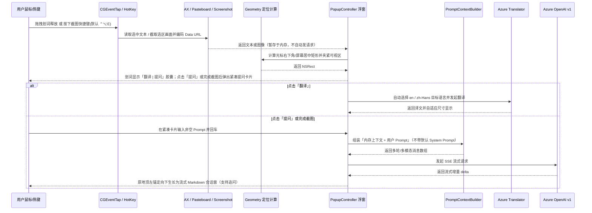

# 全局架构现状 (Architecture Overview)

> 本文件仅维护全局主干（两张 Mermaid 图 + 一组核心约束）。具体子系统或领域细节请在 `docs/architecture/` 下按需平铺新建专题 `.md` 文件。

## 1. 模块边界与源码地图

- **主控与会话浮窗**（[glint-app/main.swift](../../glint-app/main.swift)）：负责应用生命周期（`AppDelegate`）、全局鼠标划词监听（`CGEventTap`）、AX/剪贴板取词、翻译与流式对话网络请求（`translate` / `chatStream`）以及毛玻璃浮窗控制器（`PopupController`，管理紧凑提问卡片、内存上下文暂存与流式会话展开）。
- **浮窗生命周期状态机**（[glint-app/PopupLifecycle.swift](../../glint-app/PopupLifecycle.swift)）：独立描述内容窗的 `visible`、`hiddenRestorable`、`dismissed` 状态，以及图钉、外部点击、菜单恢复和新划词替换规则；配套黑盒状态转换测试位于 [glint-app/popup_lifecycle_tests.swift](../../glint-app/popup_lifecycle_tests.swift)。
- **几何定位模块**（[glint-app/Geometry.swift](../../glint-app/Geometry.swift)）：纯几何函数层，负责计算划词气泡与浮窗在屏幕可视区内的落点矩形与边界夹紧，不直接耦合 `NSScreen`/`NSEvent`，配套单测位于 [glint-app/geometry_tests.swift](../../glint-app/geometry_tests.swift)。
- **块级 Markdown 渲染**（[glint-app/Markdown.swift](../../glint-app/Markdown.swift)）：将模型输出的 Markdown（标题、多级列表、GFM 表格、代码块、行内样式）解析为 AppKit `NSAttributedString`，并通过 `CodeBlockLayoutManager` 绘制代码块圆角底色，配套单测位于 [glint-app/markdown_tests.swift](../../glint-app/markdown_tests.swift)。
- **框选截图模块**（[glint-app/Screenshot.swift](../../glint-app/Screenshot.swift)）：提供全屏遮罩框选（`RegionCapture`）、遮罩下层真实画面截取（`CGWindowListCreateImage`）及 PNG Base64 Data URL 编码。
- **快捷键录制与切换事务**（[glint-app/ScreenshotHotKey.swift](../../glint-app/ScreenshotHotKey.swift)、[glint-app/HotKey.swift](../../glint-app/HotKey.swift)、[glint-app/HotKeyRecorderControl.swift](../../glint-app/HotKeyRecorderControl.swift)）：保存标准化键码和修饰键，基础设置页直接录制组合键；候选 Carbon 热键先注册为未激活，只有配置保存与旧键注销全部成功后才启用，失败时保留原快捷键。
- **Azure 配置与协议适配**（[glint-app/Config.swift](../../glint-app/Config.swift)、[glint-app/Settings.swift](../../glint-app/Settings.swift)）：`AzureTranslatorConfig` 构造文本翻译请求并解析结果，`AzureOpenAIConfig` 构造 Azure OpenAI v1 Chat Completions 请求并解析非流式/SSE 响应；`AppConfig` 持久化两组连接信息和截图快捷键到 `~/.config/glint/config.json`。设置页提供快捷键录制及两组独立的真实连接探测；配套黑盒测试位于 [glint-app/hotkey_tests.swift](../../glint-app/hotkey_tests.swift) 与 [glint-app/azure_services_tests.swift](../../glint-app/azure_services_tests.swift)。
- **品牌图标与菜单栏矢量徽标**（[glint-app/BrandLogo.swift](../../glint-app/BrandLogo.swift)）：采用与 `ClaudeTheme` 统一的暖纸书卷（`#FAF9F5`）、深炭墨气泡与赤陶星芒（`#D97757`）设计语言，绘制 macOS 应用图标（`Glint.icns` / `NSApp.applicationIconImage`）及自适应明暗模式的 18×18 菜单栏 Template 矢量图标（`NSStatusItem`）。
- **构建与打包脚本**（[glint-app/build.sh](../../glint-app/build.sh)）：编译 `arm64 + x86_64` 通用二进制、生成 `Glint.icns` 应用图标、组装 `Glint.app`、执行代码签名并打包 `Glint.dmg`。

## 2. 核心执行链路与数据流

- **关键数据结构**：
  - `ScreenshotHotKey` 与 `ScreenshotHotKeyManager`（定义于 [glint-app/ScreenshotHotKey.swift](../../glint-app/ScreenshotHotKey.swift) 和 [glint-app/HotKey.swift](../../glint-app/HotKey.swift)）：描述截图快捷键值、录制决定、Carbon 注册、即时切换和失败补偿。
  - `AzureTranslatorConfig`、`AzureOpenAIConfig`、`AppConfig`、`PromptContextPayload`、`ConversationTurn` 与 `PromptContextBuilder`（定义于 [glint-app/Config.swift](../../glint-app/Config.swift)）：描述 Azure 双服务与截图快捷键配置、请求与响应契约，以及文本/图像上下文与用户 Prompt 的消息组装。
  - `PopupController` 会话状态（定义于 [glint-app/main.swift](../../glint-app/main.swift)）：维护内存上下文 `sessionContext`、`convo` 对话轮次、`isAwaitingInitialPrompt` 提问卡片状态以及 `generation` 异步回调作废令牌。
  - `PopupLifecycle`（定义于 [glint-app/PopupLifecycle.swift](../../glint-app/PopupLifecycle.swift)）：维护当前窗口呈现状态、是否可恢复及是否钉住，不持久化任何会话内容。

## 3. 系统不变量与边界约束

- **事件 Tap 零阻塞与自愈约束**（[glint-app/main.swift](../../glint-app/main.swift)）：`CGEventTap` 回调严禁同步休眠或耗时阻塞；取词必须派发至后台队列且由 `gFetchInFlight` 互斥串行化，防止剪贴板快照恢复竞态；遇到 `.tapDisabledByTimeout` 必须立即自愈重开。
- **截图快捷键事务约束**（[glint-app/HotKey.swift](../../glint-app/HotKey.swift)）：候选快捷键在保存前必须保持未激活；注册、保存或旧键注销任一失败时，原快捷键继续执行截图。录制期间按当前快捷键只回填录制器，不触发截图。
- **异步会话代际隔离约束**（[glint-app/main.swift](../../glint-app/main.swift)）：每次关闭浮窗、触发新划词或切换「翻译/解释」时，`generation` 令牌必须递增，所有在途的非流式/流式网络回调若 `gen != self.generation` 必须立即丢弃，严禁污染新浮窗。
- **窗口帧动画与尺寸记忆约束**（[glint-app/main.swift](../../glint-app/main.swift)）：`frameAnimations > 0` 期间严禁触发 `growToFit()` 或响应 macOS 假 `windowDidEndLiveResize` 回调，防止将动画中间态尺寸写入 `UserDefaults` 或中断自动长高。
- **单窗口恢复与明确销毁约束**（[glint-app/PopupLifecycle.swift](../../glint-app/PopupLifecycle.swift)、[glint-app/main.swift](../../glint-app/main.swift)）：未钉住的展开内容窗与紧凑提问卡片在外部点击时只能隐藏，并保留同一窗口、隐藏前位置尺寸、内存上下文及未发送草稿；紧凑提问卡片不可钉住，钉住的展开内容窗不得被外部点击或新划词替换；只有 `×`、Escape、新会话替换或退出应用可以销毁对应上下文。快捷划词胶囊不进入可恢复状态。
- **多屏坐标系翻转基准与分屏独立遮罩约束**（[glint-app/main.swift](../../glint-app/main.swift)、[glint-app/Screenshot.swift](../../glint-app/Screenshot.swift)）：Quartz（左上原点）与 AppKit（左下原点）之间的 Y 轴翻转必须以原点 `(0,0)` 所在主屏高度 `primaryScreenHeight()` 为基准，严禁使用 `NSScreen.main`（焦点屏）或多屏并集高度；框选截图（`RegionCapture`）必须为 `NSScreen.screens` 中的每块显示器分别创建独立的 `CaptureWindow` 并重写 `constrainFrameRect(_:to:)`，规避 macOS「显示器具有单独的空间」对单窗口跨屏的裁切与 `visibleFrame` 收缩。
